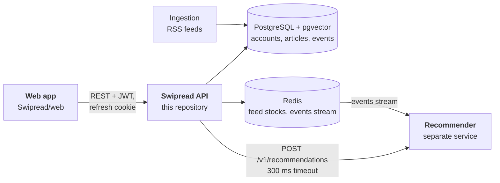
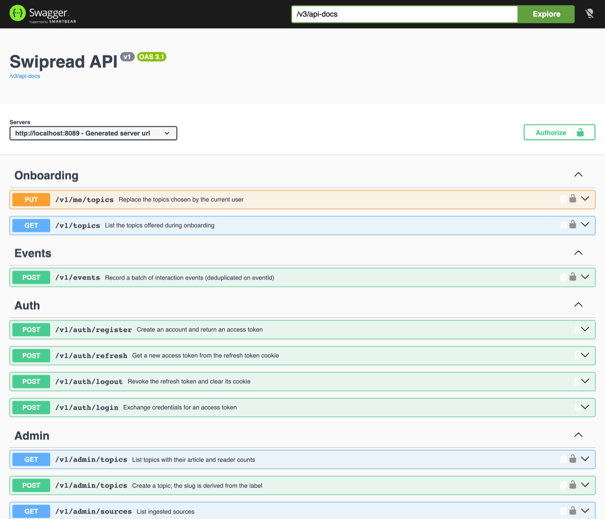

# Swipread · API

**The backend of Swipread, a feed of recommended articles you scroll one card at a time.** It manages accounts and topics, serves each reader's feed from a stock prepared in Redis, collects every interaction as an event, and feeds them to a separate recommendation service.

Java 25 · Spring Boot 4 · PostgreSQL 17 + pgvector · Redis 7.4 · Flyway · Spring Security (JWT) · springdoc-openapi · Testcontainers.


## Contents

- [How Swipread fits together](#how-swipread-fits-together)
- [Features](#features)
- [How it works](#how-it-works)
- [Getting started](#getting-started)
- [API at a glance](#api-at-a-glance)
- [Project structure](#project-structure)
- [Testing](#testing)
- [Configuration and deployment](#configuration-and-deployment)
- [Project status](#project-status)
- [Documentation](#documentation)
- [License](#license)

## How Swipread fits together



The [web app](https://github.com/Swipread/web) is the main client. The recommendation service ranks articles for each reader from the events this API streams to it; its interface is defined by a contract agreed between the two teams. Articles are written by a separate ingestion component from the sources administrators manage here.



## Features

| Readers | Administrators | Platform |
| --- | --- | --- |
| Sign up, log in, stay logged in with rotating refresh tokens | Create and rename topics, with article and reader counts | Feed served from Redis, never waiting for the recommender |
| Choose at least three topics | Add RSS/Atom sources after an automatic, SSRF-safe feed check | Fallback feed whenever the recommender fails |
| An endless feed of recommended articles | Activate, deactivate or delete sources | Events stored, aggregated and streamed through a transactional outbox |
| Like, save, share, hide, with every interaction tracked | Admin-only routes by role | OpenAPI spec with typed errors (RFC 9457 `ProblemDetail`) |
| Saved list and reading history, cursor-paginated | | Monthly partitions of the event log, dedicated database role for the recommender |
| Rename or delete the account, with all personal data | | 161 automated tests and an end-to-end scenario for Bruno and Postman |

## How it works

**A feed that never waits.** Each reader has a stock of up to 50 prepared article ids in Redis. A page pops 10; under 20 left, a background task (virtual threads, at most 64 at once) asks the recommender for more, with a 300 ms timeout. An empty stock is served synchronously from a fallback feed (topic lists, then recent articles), so a new reader gets a first page immediately. → [Feed](docs/features/feed.md)

**Signals that reshape it.** Clients post interactions in batches. A like, save, share, hide or complete read trims the stock to the next 10 articles and refills the rest with the new signal. A version counter, checked atomically by a Lua script, discards any refill computed before the change. → [Events](docs/features/events.md)

**Events published only once committed.** Events and their stream messages are written in one transaction, the messages to an outbox table; a relay publishes them to the Redis stream every 200 ms with `FOR UPDATE SKIP LOCKED`, so several instances share the work and a Redis outage never fails a request. The recommender deduplicates the rare message sent twice. → [Events](docs/features/events.md#publication-through-the-outbox)

**Sessions that are safe and long.** 15-minute JWT access tokens and opaque refresh tokens in an HttpOnly, `SameSite=Strict` cookie, hashed in the database, rotated at each use, with theft detection by family and a 10-second grace period for concurrent tabs. → [Authentication](docs/features/auth.md)

**A server that will not fetch what it should not.** Adding a source downloads an admin-supplied URL. Schemes, ports and every redirect are checked, and the HTTP client resolves hosts through the same policy that refuses internal addresses, which also defeats DNS rebinding. → [Sources](docs/features/sources.md)

## Getting started

Requirements: JDK 25 and Docker (Maven comes with the wrapper).

```bash
git clone https://github.com/Swipread/api.git
cd api
./mvnw spring-boot:run -Dspring-boot.run.profiles=dev
```

The `dev` profile starts PostgreSQL and Redis with Docker Compose, creates the schema, loads 8 topics and 300 sample articles, creates the admin account `admin@swipread.dev` / `password123`, enables a mock recommender, and allows the web app's dev server (`http://localhost:5173`).

| URL | |
| --- | --- |
| <http://localhost:8080/swagger-ui.html> | Swagger UI |
| <http://localhost:8080/v3/api-docs> | OpenAPI spec |
| <http://localhost:8080/actuator/health> | Health |

Try it with curl:

```bash
TOKEN=$(curl -s -X POST localhost:8080/v1/auth/register -H 'Content-Type: application/json' \
  -d '{"email":"me@example.org","password":"password123","displayName":"Me"}' | jq -r .accessToken)
curl -s -X PUT localhost:8080/v1/me/topics -H "Authorization: Bearer $TOKEN" \
  -H 'Content-Type: application/json' -d '{"topicIds":[1,2,3]}'
curl -s localhost:8080/v1/feed -H "Authorization: Bearer $TOKEN" | jq '.items[].title'
```

More, including IntelliJ, database access and troubleshooting: [Getting started](docs/getting-started.md).

## API at a glance

| Area | Endpoints |
| --- | --- |
| Auth | `POST /v1/auth/register` · `login` · `refresh` · `logout` |
| Profile | `GET` · `PATCH` · `DELETE /v1/me`, `PUT /v1/me/topics`, `GET /v1/topics` |
| Feed | `GET /v1/feed` |
| Events | `POST /v1/events` |
| Lists | `GET /v1/me/saved`, `GET /v1/me/history` |
| Admin | `/v1/admin/topics`, `/v1/admin/sources` |

Full reference: [API reference](docs/api.md).

## Project structure

```text
src/main/java/swipread/api/
├── auth/       sign-up, login, refresh tokens
├── user/       profile, account deletion, saved list, history
├── topic/      topics and their administration
├── article/    article reads
├── source/     source administration, feed check, SSRF protection
├── feed/       Redis stock, paging, refill, fallback
├── reco/       recommender client and mock
├── event/      event ingestion, aggregation, outbox, partitions
├── security/   JWT, roles, CORS
└── common/     errors, ids, OpenAPI, validation, scheduling
src/main/resources/db/
├── migration/  Flyway migrations V1–V7
├── seed/       topics and admin account (dev, test)
└── dev-data/   sample articles (dev)
```

Code is organised by feature; Flyway owns the schema. → [Architecture](docs/architecture.md)

## Testing

```bash
./mvnw test
```

161 unit and integration tests run in about 30 seconds; integration tests start their own PostgreSQL and Redis with Testcontainers (Docker required). An end-to-end scenario of 47 requests exists for both Bruno and Postman. → [Testing](docs/testing.md)

## Configuration and deployment

In production the API runs without a profile and reads everything from environment variables (database, Redis, JWT secret, recommender URL, allowed origins). A container image example has been built and run against a fresh database. → [Configuration](docs/configuration.md), [Deployment](docs/deployment.md)

## Project status

The user stories of the reader and admin journeys are implemented, together with the requests of the web team and a series of hardening steps (outbox, stock versioning, refresh tokens, SSRF protection). The interface with the recommender is at contract v1.4.

Open points, tracked in [Decisions](docs/decisions.md):

- the recommender's database permissions (decision 17) are to be confirmed with the recommendation team;
- whether topic changes should be announced to the recommender on the events stream.

## Documentation

| | |
| --- | --- |
| **Guides** | [Getting started](docs/getting-started.md) · [Architecture](docs/architecture.md) · [API reference](docs/api.md) · [Flows](docs/flows.md) · [Database](docs/database.md) · [Configuration](docs/configuration.md) · [Testing](docs/testing.md) · [Deployment](docs/deployment.md) · [Decisions](docs/decisions.md) · [FAQ](docs/faq.md) · [Glossary](docs/glossary.md) |
| **Modules** | [Authentication](docs/features/auth.md) · [Account, saved and history](docs/features/account.md) · [Topics](docs/features/topics.md) · [Feed](docs/features/feed.md) · [Events](docs/features/events.md) · [Recommendation](docs/features/recommendation.md) · [Sources](docs/features/sources.md) |

Start from the [documentation index](docs/README.md).

## License

© 2026 Swipread. All rights reserved.

The source is published for reference only; no license is granted to use, copy, modify or distribute it without written permission from Swipread.
