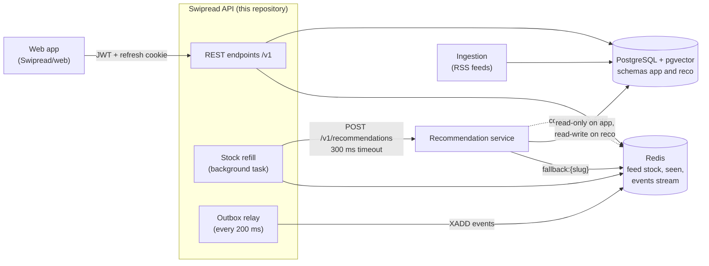
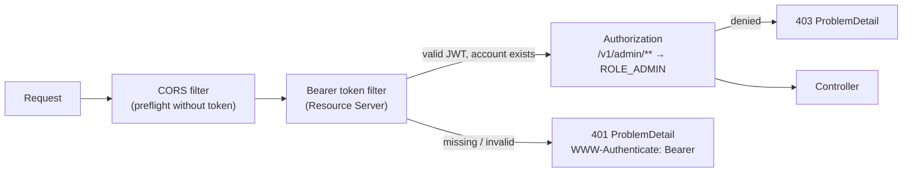

# Architecture

## Overview

The principles come from the backend / recommender contract:

- **Ids only.** The recommender returns article ids; the API loads the content from the database.
- **Business writes.** Only the API writes business data: accounts, topic choices, events.
- **Never wait.** The reader never waits for the recommender: the feed is served from a Redis stock filled in the background.
- **Always a fallback.** Any recommender failure ends in a fallback feed.

The ingestion that fills `app.sources` → `app.articles` and the recommendation service are separate components; this repository manages sources (admin), reads articles, and talks to the recommender.

## Code organisation

Code is organised by feature, not by technical layer, under `swipread.api`:

| Package | Purpose | Main classes | Guide |
| --- | --- | --- | --- |
| `auth` | Sign-up, login, refresh tokens (HttpOnly cookie, rotation, logout) | `AuthController`, `AuthService`, `RefreshTokenService`, `RefreshCookies`, `AuthProperties` | [Authentication](features/auth.md) |
| `user` | Profile, account deletion, saved articles, history | `UserController`, `UserService`, `SavedArticleService`, `HistoryService`, `UserArticleStates`, `User` | [Account, saved and history](features/account.md) |
| `topic` | Topics, onboarding choices, topic administration | `TopicController`, `TopicService`, `AdminTopicController`, `TopicAdminService`, `Slugs`, `UserTopicsChanged` | [Topics](features/topics.md) |
| `article` | Reading articles (written by the ingestion) | `ArticleQueryService`, `Article`, `Source` | [Feed](features/feed.md) |
| `source` | Source administration, feed check (Apache HttpClient 5 with a controlled DNS resolver), SSRF protection | `AdminSourceController`, `SourceAdminService`, `RomeFeedProbe`, `FeedAddressPolicy` | [Sources](features/sources.md) |
| `feed` | Redis stock, paging, refill, fallback | `FeedService`, `FeedStore`, `FeedRefiller`, `FallbackFeedProvider`, `TopicsChangedListener` | [Feed](features/feed.md) |
| `reco` | Recommender client, mock (recommendations and stream consumer) | `RecommendationClient`, `HttpRecommendationClient`, `MockRecommendationClient`, `MockEventsConsumer` | [Recommendation](features/recommendation.md) |
| `event` | Event collection, aggregation and publication | `EventService`, `EventRepository`, `EventOutbox`, `OutboxRelay`, `EventStreamPublisher`, `EventPartitionJob`, `EventErasure` | [Events](features/events.md) |
| `security` | JWT, roles, CORS, Spring Security setup | `SecurityConfig`, `JwtService`, `CorsProperties`, `@CurrentUserId` | below |
| `common` | Cross-cutting | `ApiExceptionHandler`, `ApiException`, `IdGenerator`, `OpenApiConfig`, `ValidationConfig`, `ClockConfig`, `SchedulingConfig` | below |

Packages talk through public services; `feed` depends on `topic` (fallback by topic) and `event` on `feed` (invalidation), so `topic` notifies `feed` with a Spring event (`UserTopicsChanged`) instead of calling it.

### Rules

- **DTOs.** JSON goes through Java records in `dto` sub-packages. JPA entities are never exposed.
- **Schema.** Flyway owns the schema; Hibernate only validates the entities (`ddl-auto: validate`). A committed migration is never edited: add a new one.
- **Data access.** Spring Data JPA by default; `JdbcTemplate` where SQL matters (`ON CONFLICT` upserts on `app.events` and `app.user_articles`, keyset pagination, outbox, refresh tokens, row locks).
- **Current user.** Controllers receive it as `@CurrentUserId String userId`, read from the JWT `sub` claim. A `userId` is never accepted from a request body.
- **Time.** A `Clock` bean is injected wherever time matters, so tests can control it. Dates are `Instant`, JDBC sessions are in UTC.
- **Documentation.** Every endpoint carries springdoc annotations; `OpenApiConfig` adds the `ProblemDetail` error responses to the spec.

## Security

- **Access tokens.** HS256 JWTs signed with `swipread.jwt.secret` (at least 32 characters). Claims: `iss = swipread-api`, `sub = userId`, `roles` (`["READER"]` or `["ADMIN"]`), `iat`, `exp` (15 minutes). They are validated by Spring Security's OAuth2 Resource Server, with an extra validator that checks the account still exists: the token of a deleted account is refused at once.
- **Refresh tokens.** Opaque random tokens in the `swipread_refresh` cookie (HttpOnly, `SameSite=Strict`, path `/v1/auth`, `Secure` outside `dev` and `test`), stored as SHA-256 hashes, rotated at each use, with reuse detection. See [Authentication](features/auth.md).
- **Roles.** The `roles` claim becomes the `ROLE_READER` or `ROLE_ADMIN` authority. `/v1/admin/**` requires `ROLE_ADMIN`. The role is read from the database when a token is issued, so a change applies at the next renewal.
- **Passwords.** BCrypt. Login always runs a BCrypt check, even for an unknown email, so the response time does not reveal whether an account exists.
- **Stateless.** No server session. CSRF protection is disabled: authenticated endpoints only accept the `Authorization` header, which a browser never adds on its own, and the only cookie is `SameSite=Strict` and scoped to `/v1/auth`.
- **CORS.** The CORS filter runs before authentication, so preflight `OPTIONS` requests need no token. Allowed origins come from `swipread.cors.allowed-origins`, with credentials allowed (for the refresh cookie).
- **Public routes**: `POST /v1/auth/register`, `/login`, `/refresh`, `/logout`, `/v3/api-docs/**`, `/swagger-ui/**`, `/actuator/health/**`, `/actuator/info`. Everything else requires a valid access token. A request to a public route that still carries an invalid `Authorization` header is rejected by the bearer filter: clients must not send one to `/v1/auth/*`.
- **Outbound requests.** Only the feed check of a new source downloads a URL chosen by a user (an admin). It is protected against SSRF, see [Sources](features/sources.md).

## Error handling

`ApiExceptionHandler` (a `ResponseEntityExceptionHandler`) turns every error into an RFC 9457 `ProblemDetail`:

| Origin | Status | Body |
| --- | --- | --- |
| Bean Validation (`@Valid` body, constrained parameters) | 400 | `detail: "Request validation failed"`, `errors: [{ field, code, message }]` |
| `ApiException` (business errors: 400, 401, 404, 409, 422) | carried by the exception | `title`, `detail` in English |
| Unreadable JSON, unsupported method, unknown route… | Spring MVC's standard status | standard `ProblemDetail` |
| Authentication / authorisation (also from the security filters) | 401 / 403 | `ProblemDetail`, `WWW-Authenticate: Bearer` on 401 |
| Any other exception | 500 | detail hidden, stack trace in the logs |

Validation messages are always in English (`ValidationConfig` fixes the message locale), and each field error carries the constraint name in `code`, so clients can show their own wording.

## Identifiers

| Prefix | Generated by | Format |
| --- | --- | --- |
| `u_` | API (`IdGenerator`) | ULID: 26 characters (Crockford base32), sortable by creation time |
| `e_` | clients for reader events; API (`IdGenerator`) for `user_deleted` messages | UUID or ULID |
| `a_` | ingestion | free |
| `r_` | recommender (the mock: 12 hexadecimal characters) | free |
| `s_` | clients | free |

Refresh tokens and their families use UUIDs internally and are never exposed.
