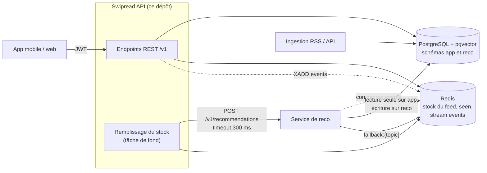
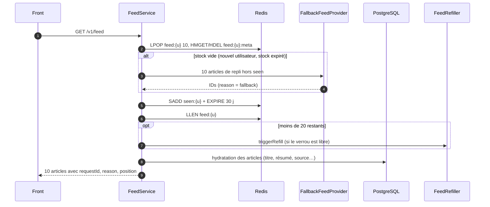
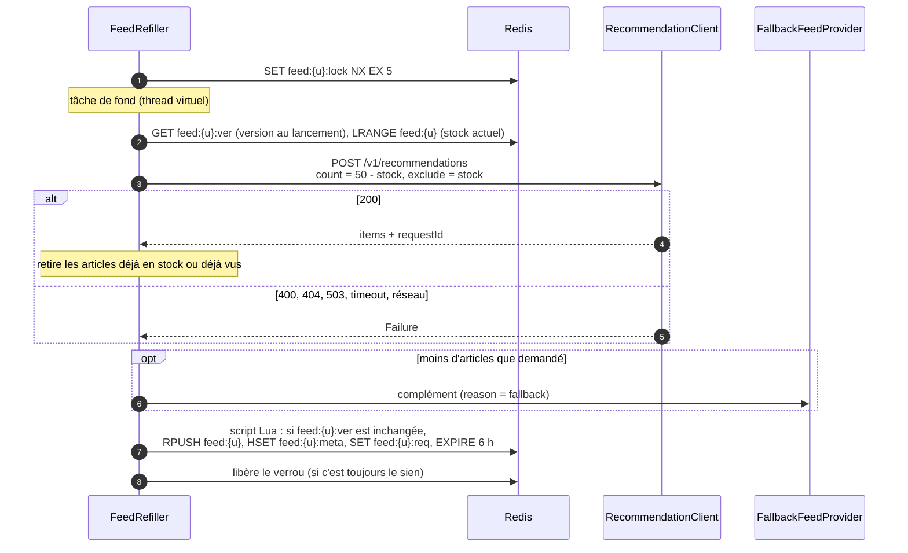
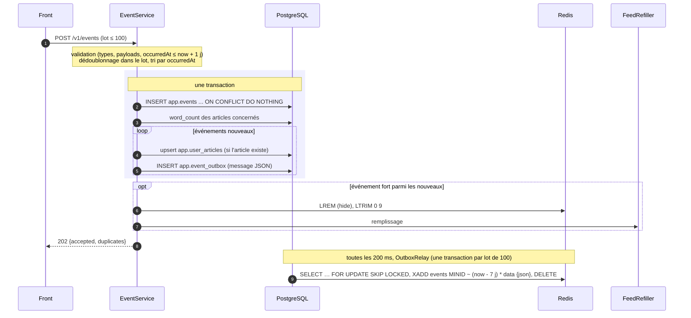

# Architecture

## Vue d'ensemble

Les principes viennent du [contrat backend / reco](Contrat%20backend%20reco.md) :

- **IDs seulement.** La reco ne renvoie que des IDs d'articles ; c'est le backend qui va chercher le contenu en base.
- **Écriture métier.** Le backend est le seul à écrire les données métier : comptes, choix de thèmes, événements.
- **Pas d'attente.** L'utilisateur n'attend jamais la reco : le feed est servi depuis un stock Redis, rempli en arrière-plan.
- **Repli.** Toute panne de la reco aboutit à un feed de repli.

## Organisation du code

Le code est organisé par fonctionnalité, pas par couche technique. Tout est sous `swipread.api` :

| Package | Rôle | Classes principales |
| --- | --- | --- |
| `auth` | Inscription, connexion, refresh tokens (cookie HttpOnly, rotation, déconnexion) | `AuthController`, `AuthService`, `RefreshTokenService`, `RefreshCookies`, `AuthProperties` |
| `user` | Profil, suppression de compte, sauvegardés, historique | `UserController`, `UserService`, `SavedArticleService`, `HistoryService`, `UserArticleStates`, entité `User` |
| `topic` | Thèmes, onboarding, administration des thèmes | `TopicController`, `TopicService`, `AdminTopicController`, `TopicAdminService`, entités `Topic`, `UserTopic`, événement `UserTopicsChanged` |
| `article` | Lecture des articles (écrits par l'ingestion) | `ArticleQueryService`, entités `Article`, `Source` |
| `source` | Administration des sources, vérification des flux RSS/Atom (Apache HttpClient 5, résolveur DNS contrôlé), protection SSRF | `AdminSourceController`, `SourceAdminService`, `FeedProbe`, `RomeFeedProbe`, `FeedAddressPolicy`, `SourceProperties` |
| `feed` | Stock Redis, pagination, remplissage, repli | `FeedService`, `FeedStore`, `FeedRefiller`, `FallbackFeedProvider`, `TopicsChangedListener` |
| `reco` | Client du service de reco, mock (appel et consommation du stream) | `RecommendationClient`, `HttpRecommendationClient`, `MockRecommendationClient`, `MockEventsConsumer` |
| `event` | Collecte, agrégation et publication des événements | `EventService`, `EventRepository`, `EventOutbox`, `OutboxRelay`, `EventStreamPublisher`, `EventPartitionJob`, `EventErasure` |
| `security` | JWT, rôles, CORS, configuration Spring Security | `SecurityConfig`, `JwtService`, `CorsProperties`, `@CurrentUserId` |
| `common` | Transverse | `ApiExceptionHandler`, `ApiException`, `IdGenerator`, `OpenApiConfig`, `ValidationConfig` (messages de validation toujours en anglais) |

Règles :

- **DTO.** Les échanges JSON passent par des records Java dans les sous-packages `dto`. Une entité JPA n'est jamais exposée dans l'API.
- **Schéma.** Le schéma de la base est géré uniquement par Flyway. Hibernate se contente de vérifier les entités (`ddl-auto: validate`).
- **Accès à la base.** `app.events` et `app.user_articles` sont écrites en SQL (`JdbcTemplate`) pour profiter de `ON CONFLICT`. Le reste passe par Spring Data JPA.
- **Utilisateur courant.** Les contrôleurs le reçoivent via `@CurrentUserId String userId`, qui lit le claim `sub` du JWT.

## Le feed

### Le stock Redis

Chaque utilisateur a une liste Redis `feed:{userId}` d'au plus 50 IDs d'articles déjà calculés. Un appel à `GET /v1/feed` en consomme 10. Quand il en reste moins de 20, un remplissage est lancé en arrière-plan.

| Clé | Type | TTL | Contenu |
| --- | --- | --- | --- |
| `feed:{userId}` | List | 6 h | IDs d'articles dans l'ordre d'affichage |
| `feed:{userId}:meta` | Hash | 6 h | `articleId → requestId\|reason` : lot d'origine de chaque article du stock (ajout au contrat, voir [décisions](decisions.md)) |
| `feed:{userId}:req` | String | 6 h | `requestId` du dernier lot reçu de la reco |
| `feed:{userId}:lock` | String | 5 s | Verrou qui empêche deux remplissages simultanés |
| `feed:{userId}:ver` | String | 6 h | Version du stock, incrémentée avant chaque invalidation ou vidage (contrat v1.2) |
| `seen:{userId}` | Set | 30 j (renouvelé à chaque page) | Articles déjà servis |
| `fallback:{slug}` | List | 1 h (écrit par la reco) | Articles récents et populaires par thème |
| `events` | Stream | ~7 j | Événements publiés pour la reco |

Les valeurs de 10, 50 et 20 sont réglables, voir [Configuration](configuration.md).

### Servir une page

- Si un ID n'existe plus en base, l'article est simplement sauté : la page peut alors en compter moins de 10.
- Si le stock est vide, la page vient directement du repli, sans appel à la reco, et n'entre pas dans le stock. Le remplissage par la reco démarre dans la foulée.

### Remplir le stock

- **Exécution.** Le remplissage tourne sur des threads virtuels, avec au plus 64 remplissages simultanés (`FeedConfig`). Une erreur est journalisée et le verrou toujours libéré.
- **Seen.** Les articles de `seen:{userId}` sont retirés de la réponse de la reco. La reco exclut l'historique en base, mais un article servi n'y apparaît qu'à l'arrivée de ses événements, jusqu'à 5 s plus tard. Le Set n'est jamais lu en entier (jusqu'à 30 jours d'historique) : `SMISMEMBER` ne teste que les articles candidats (`FeedStore.seenAmong`).
- **Version.** Un remplissage note `feed:{userId}:ver` à son lancement. Son lot n'est ajouté que si la version n'a pas changé : une invalidation ou un changement de thèmes survenu pendant le calcul (jusqu'à 300 ms d'appel à la reco) l'écarte, au lieu d'ajouter des articles calculés sans ce signal. Le remplissage recalcule alors une fois, verrou toujours tenu. La version est incrémentée **avant** de modifier le stock : un ajout qui arriverait entre les deux est déjà refusé.
- **Verrou.** Il porte un jeton aléatoire et n'est libéré que par son propriétaire (script Lua). Son TTL de 5 s protège contre une instance qui s'arrêterait en plein remplissage.

### Feed de repli

`FallbackFeedProvider` :

1. Lit les listes `fallback:{slug}` des thèmes choisis par l'utilisateur. Ces listes sont écrites par un batch de la reco.
2. Les fusionne, les mélange, puis retire les articles déjà en stock et ceux de `seen:{userId}` (`SMISMEMBER` sur ces seuls candidats).
3. Complète si besoin avec les articles les plus récents en base (50 au plus), lus par lots de 100 en pagination par clé sur `(published_at, id)` : seuls les articles de chaque lot sont testés dans `seen`.

Les articles de repli portent `requestId = "fallback"` et `reason = "fallback"`.

### Invalidation sur événement fort

Un `like`, `save`, `share`, `hide`, ou un `read` complet : `scrollDepth > 0.8`, ou `readMs` ≥ 60 % du temps de lecture estimé (`wordCount` / 230 mots par minute), signale un changement de goûts. Le backend applique alors deux étapes :

1. **Garder la suite immédiate.** `INCR feed:{userId}:ver`, puis `LTRIM feed:{userId} 0 9` (script Lua qui purge aussi les métadonnées des articles retirés) : les 10 prochains articles restent, pour que le scroll reste fluide.
2. **Recalculer le reste.** Un remplissage est relancé, qui tient compte du nouveau signal.

Un `hide` retire en plus l'article masqué du stock (`LREM`).

### Changement de thèmes

Un `PUT /v1/me/topics` rend tout le stock obsolète (US4). `TopicService` publie un événement Spring `UserTopicsChanged` ; `TopicsChangedListener`, dans `feed`, le reçoit **après le commit** (`@TransactionalEventListener`) et supprime `feed:{userId}`, `:meta` et `:req`. `seen:{userId}` et le verrou sont conservés.

Aucun remplissage n'est lancé à ce moment : le `GET /v1/feed` suivant trouve un stock vide, sert sa première page par le repli (nouveaux thèmes) et lance la reco en arrière-plan, comme pour un nouvel utilisateur. L'événement évite une dépendance de `topic` vers `feed`, qui dépend déjà de `topic` pour le repli.

## Les événements

- **Dédoublonnage.** Il s'appuie sur la clé primaire `(event_id, occurred_at)`. Un renvoi identique du front est ignoré : il n'est ni réécrit, ni republié, ni réagrégé, et ne relance pas d'invalidation.
- **Outbox.** Les messages sont écrits dans `app.event_outbox`, dans la même transaction que les événements : un message ne part que si les événements sont enregistrés, et une panne de Redis ne fait plus échouer `POST /v1/events`. `OutboxRelay` publie les lignes dans l'ordre d'écriture toutes les 200 ms, puis les supprime. Si Redis échoue en cours de lot, la transaction est annulée et le lot republié au tour suivant : un message peut alors partir deux fois, ce que la reco tolère (idempotente sur `eventId`). Plusieurs instances de l'API se partagent l'outbox grâce à `FOR UPDATE SKIP LOCKED` ; l'ordre n'est alors garanti qu'à l'intérieur d'un lot.
- **Message publié.** Le format est celui du contrat (`version: 1`, `userId`, `receivedAt`), avec `payload.articleWordCount` ajouté. Il est publié dans un champ unique `data`.
- **Agrégation dans `app.user_articles`** :

| Type | Effet |
| --- | --- |
| tous | crée la ligne si besoin, `first_seen_at` = plus ancien `occurredAt` |
| `view` | `total_dwell_ms += dwellMs` |
| `open` | `opened_at` = max(ancien, `occurredAt`) |
| `read` | `max_scroll` = max(ancien, `scrollDepth`) si présent ; `opened_at` = max(ancien, `occurredAt`) |
| `like` / `unlike` | `liked_at` = `occurredAt` / `NULL` |
| `save` / `unsave` | `saved_at` = `occurredAt` / `NULL` |
| `hide` | `hidden_at` = `occurredAt` |

- **Article inconnu.** Si l'article n'existe pas en base, l'événement est tout de même écrit et publié, mais pas agrégé, à cause de la clé étrangère de `app.user_articles`.
- **Partitions.** `EventPartitionJob` crée les partitions mensuelles de `app.events` au démarrage et chaque nuit, voir [Base de données](database.md).

## Suppression de compte

`DELETE /v1/me` (`UserService.delete`) :

1. Dans une transaction : suppression des événements de l'utilisateur, écriture d'un message `user_deleted` dans l'outbox (`EventErasure`), puis suppression du compte, qui emporte `user_topics` et `user_articles` en cascade. Le message part sur le stream `events` après le commit, par `OutboxRelay`.
2. Après le commit : suppression des clés Redis `feed:{userId}`, `:req`, `:lock`, `:meta`, `:ver` et `seen:{userId}`.

La reco efface ses propres données (`reco.user_profiles`) à réception du message. Le token restant est refusé dès la requête suivante.

## Le client de reco

`RecommendationClient` a deux implémentations, choisies par profil :

| Implémentation | Profil | Comportement |
| --- | --- | --- |
| `HttpRecommendationClient` | tout sauf `mock-reco` | `POST {swipread.reco.base-url}/v1/recommendations`, délai de connexion et de réponse de 300 ms |
| `MockRecommendationClient` | `mock-reco` | `count` articles tirés au hasard en base, hors `exclude` et hors historique de l'utilisateur ; `score: 0.5`, `reason: "explore"`, `modelVersion: "mock"` |
| `MockEventsConsumer` | `mock-reco` | Lit le stream `events` dans le groupe de consommateurs `mock-reco` (créé au démarrage s'il manque, à partir des nouveaux messages) et logge chaque message : `Mock reco received <type> for <userId> …`. Les messages sont acquittés à la lecture ; plusieurs instances de l'API se partagent le groupe, et chacune s'en retire à l'arrêt. La vraie reco utilisera son propre groupe |

Le client ne lève pas d'exception : il renvoie un `RecommendationResult` qui vaut `Success` ou `Failure`.

| Réponse de la reco | Résultat | Réaction |
| --- | --- | --- |
| 200 | `Success` | Articles ajoutés au stock, complétés par le repli si besoin |
| 400 | `Failure(BAD_REQUEST)` | Log en erreur (bug côté backend), repli, pas de nouvel essai |
| 404 | `Failure(UNKNOWN_USER)` | Repli (nouvel inscrit inconnu de la reco) |
| 5xx, timeout, erreur réseau, corps vide | `Failure(UNAVAILABLE)` | Repli, nouvel essai au prochain passage sous le seuil |

## Sécurité

- **Tokens.** JWT HS256 signés par l'API avec `swipread.jwt.secret` (au moins 32 caractères). Claims : `iss = swipread-api`, `sub = userId`, `roles` (`["READER"]` ou `["ADMIN"]`), `iat`, `exp` (15 min, renouvelés par le refresh token en cookie, voir l'[API](api.md#post-v1authrefresh)). Ils sont validés par le Resource Server OAuth2 de Spring Security, qui vérifie aussi que le compte existe toujours : le token d'un compte supprimé est refusé.
- **Rôles.** Le claim `roles` devient l'autorité `ROLE_READER` ou `ROLE_ADMIN`. `/v1/admin/**` exige `ROLE_ADMIN`. Une promotion en base ne prend effet qu'au token suivant.
- **Mots de passe.** Hachés en BCrypt. La connexion fait toujours une vérification BCrypt, même pour un email inconnu, pour ne pas révéler par le temps de réponse si un compte existe.
- **Sans état.** Aucune session serveur et pas de CSRF, puisque l'authentification passe uniquement par le Bearer token.
- **CORS.** Le filtre CORS passe avant l'authentification : les requêtes préalables `OPTIONS` n'ont pas besoin de token. Origines autorisées : `swipread.cors.allowed-origins`, voir [Configuration](configuration.md).
- **Accès publics** : `POST /v1/auth/register`, `POST /v1/auth/login`, `/v3/api-docs/**`, `/swagger-ui/**`, `/actuator/health/**`, `/actuator/info`. Tout le reste exige un token.
- **Erreurs 401/403.** Elles passent par le `@RestControllerAdvice` et sortent donc aussi en ProblemDetail, avec `WWW-Authenticate: Bearer` pour les 401.

## Gestion des erreurs

`ApiExceptionHandler` (étend `ResponseEntityExceptionHandler`) produit toutes les erreurs au format ProblemDetail (RFC 9457) :

| Origine | Statut |
| --- | --- |
| Validation Bean Validation (`@Valid`, paramètres) | 400, avec `errors: [{field, message}]` |
| `ApiException` (erreurs métier : 400, 401, 404, 409) | statut porté par l'exception |
| JSON illisible, méthode non supportée, ressource inconnue… | statut Spring MVC standard |
| Authentification / autorisation | 401 / 403 |
| Toute autre exception | 500, détail masqué, trace dans les logs |

## Identifiants

| Préfixe | Généré par | Format |
| --- | --- | --- |
| `u_` | backend (`IdGenerator`) | ULID : 26 caractères, triable par date de création |
| `a_` | ingestion | libre |
| `r_` | reco (mock : 12 caractères hexadécimaux) | libre |
| `e_` | front | UUID ou ULID |
| `s_` | front | libre |
