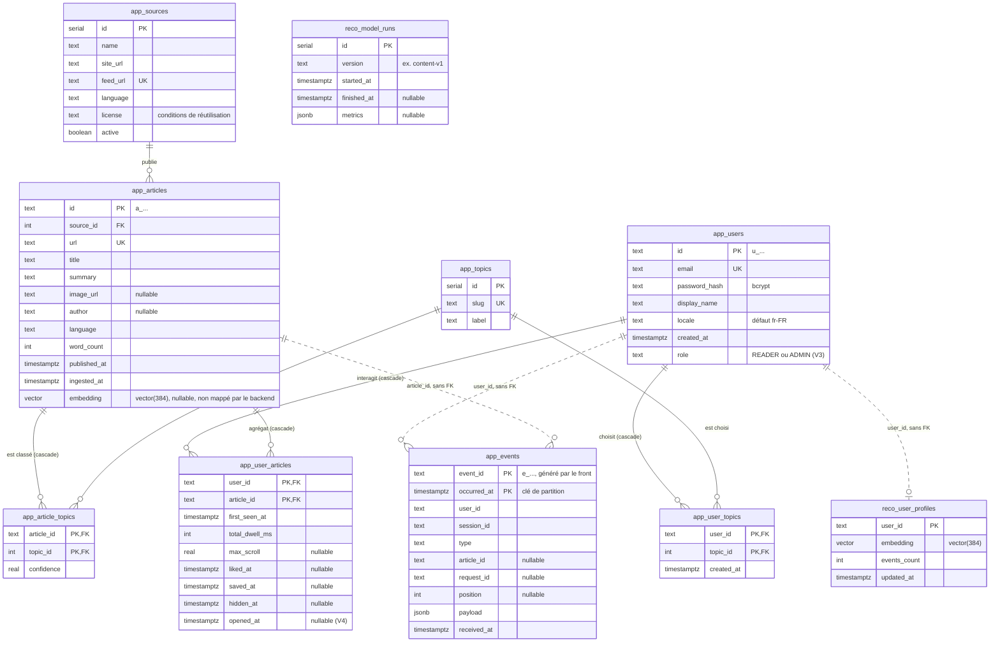

# Schéma de la base de données

Une seule base PostgreSQL avec l'extension pgvector, découpée en deux schémas :

- `app` : données métier, écrites par le backend, l'ingestion et l'admin ;
- `reco` : données internes de l'algo de recommandation.

Source de vérité : les migrations Flyway `src/main/resources/db/migration` (V1 = DDL du [contrat](Contrat%20backend%20reco.md), V2 = partition par défaut des événements, V3 = rôle des utilisateurs, V4 = date d'ouverture pour l'historique, V5 = rôle PostgreSQL de la reco, V6 = outbox du stream des événements, V7 = refresh tokens). Ce document doit suivre toute nouvelle migration.

## Diagramme

Les noms d'entité s'écrivent `schéma_table` (Mermaid n'accepte pas le point). Les traits pleins sont des clés étrangères ; les pointillés sont des liens logiques sans contrainte en base.

## Tables

| Table | Écrite par | Contenu |
| --- | --- | --- |
| `app.users` | backend | Comptes, langue préférée, rôle (`READER` ou `ADMIN`, migration V3) |
| `app.topics` | admin (seed en dev) | Thèmes proposés à l'onboarding |
| `app.user_topics` | backend | Thèmes choisis par chaque utilisateur (`PUT /v1/me/topics`) |
| `app.sources` | admin | Flux RSS et APIs ingérés, avec leur licence |
| `app.articles` | ingestion | Métadonnées, résumé, embedding |
| `app.article_topics` | ingestion | Thèmes détectés par article, avec un score de confiance |
| `app.events` | backend | Historique brut des événements (`POST /v1/events`), partitionné par mois |
| `app.refresh_tokens` | backend | Refresh tokens (V7), hachés en SHA-256 : famille (une connexion sur un appareil), expiration glissante, révocation et remplaçant ; supprimés avec le compte, purgés chaque nuit un jour après expiration ; inaccessibles au rôle `swipread_reco` |
| `app.event_outbox` | backend | Messages en attente de publication sur le stream `events` (V6), supprimés une fois publiés ; interne au backend, inaccessible au rôle `swipread_reco` |
| `app.user_articles` | backend | État agrégé par couple utilisateur/article : temps passé, scroll max, like, sauvegarde, masquage, dernière ouverture |
| `reco.user_profiles` | reco | Vecteur de goûts de chaque utilisateur |
| `reco.model_runs` | reco | Historique des entraînements et de leurs métriques |

`app.events` est la source de vérité : `app.user_articles` et `reco.user_profiles` peuvent être recalculés à partir d'elle.

## Points à connaître

**Clés étrangères et suppression**
- `ON DELETE CASCADE` : supprimer un utilisateur supprime ses `user_topics` et `user_articles` ; supprimer un article supprime ses `article_topics` et `user_articles`.
- `app.events` n'a aucune clé étrangère, volontairement : l'insertion reste rapide et l'historique survit à la suppression d'un article. La suppression d'un compte (`DELETE /v1/me`) efface explicitement ses événements (`DELETE FROM app.events WHERE user_id = …`, via `events_user_idx`).
- `reco.user_profiles.user_id` n'a pas non plus de clé étrangère vers `app.users`.

**Partitionnement de `app.events`**
- La table est partitionnée par plage sur `occurred_at`, une partition par mois (`app.events_AAAA_MM`).
- La clé primaire `(event_id, occurred_at)` sert au dédoublonnage des renvois du front.
- `app.events_default` (migration V2) reçoit les événements hors des partitions existantes au lieu de faire échouer l'insertion.
- Au démarrage puis chaque nuit à 3 h UTC, le backend crée les partitions du mois courant et du mois suivant (`EventPartitionJob`).
- Les connexions JDBC sont en UTC, donc les bornes de partition sont des minuits UTC.

**Index**

| Index | Usage |
| --- | --- |
| `articles_published_idx` (`published_at DESC`) | Feed de repli : articles les plus récents |
| `articles_embedding_idx` (HNSW, `vector_cosine_ops`) | Recherche des plus proches voisins par la reco (opérateur `<=>`) |
| `events_user_idx` (`user_id, occurred_at DESC`) | Historique d'un utilisateur |
| `user_articles_saved_idx` (`user_id, saved_at DESC`, partiel `saved_at IS NOT NULL`) | `GET /v1/me/saved` |
| `user_articles_opened_idx` (`user_id, opened_at DESC`, partiel `opened_at IS NOT NULL`, V4) | `GET /v1/me/history` |

**Côté backend**
- Le backend ne mappe pas la colonne `embedding` : elle est écrite par l'ingestion et lue par la reco.
- `app.events` et `app.user_articles` sont écrites en SQL (`JdbcTemplate`, `ON CONFLICT`). Le reste passe par JPA en `ddl-auto: validate`.
- Données de seed : `db/seed` charge les thèmes et le compte `admin@swipread.dev` / `password123` (profils dev et test), `db/dev-data` charge 300 articles d'exemple (profil dev uniquement).

**Rôles applicatifs** : il n'y a pas d'écran pour nommer un administrateur. En production : `UPDATE app.users SET role = 'ADMIN' WHERE email = '…'`, puis reconnexion de l'utilisateur.

**Droits de la reco** (V5) : rôle de groupe `swipread_reco`, **sans connexion**.

| Schéma | Droits |
| --- | --- |
| `app` | `SELECT` sur toutes les tables, y compris celles créées plus tard par le backend (droits par défaut : futures migrations, partitions mensuelles de `app.events`). Sur `app.users`, seulement les colonnes `id`, `locale` et `created_at` : ni email, ni hash de mot de passe, ni nom affiché |
| `reco` | Lecture et écriture sur les tables et séquences, création de tables (`CREATE` sur le schéma) |

L'utilisateur qui se connecte est créé par l'exploitation et rattaché à ce rôle (voir la [configuration](configuration.md#mise-en-production--check-list)). Un rôle PostgreSQL étant global au serveur, V5 échoue avec un message explicite si `swipread_reco` n'existe pas et que l'utilisateur de migration n'a pas le droit `CREATEROLE` : un administrateur doit alors le créer avant (`CREATE ROLE swipread_reco NOLOGIN`).
