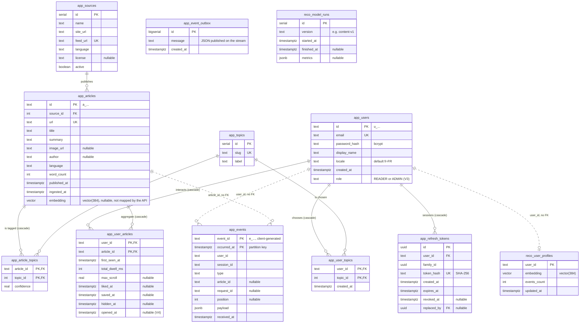

# Database

One PostgreSQL 17 database with the pgvector extension, split into two schemas:

- `app`: business data, written by the API, the ingestion and admins;
- `reco`: the recommendation service's internal data.

Source of truth: the Flyway migrations in `src/main/resources/db/migration`. Keep this page in sync with every new migration.

| Migration | Content |
| --- | --- |
| V1 | Schema from the backend / recommender contract (tables, indexes, the October 2026 partition of `app.events`) |
| V2 | `app.events_default` partition |
| V3 | `app.users.role` (`READER` or `ADMIN`) |
| V4 | `app.user_articles.opened_at` and its index, backfilled from `app.events` |
| V5 | `swipread_reco` group role and its privileges |
| V6 | `app.event_outbox` |
| V7 | `app.refresh_tokens` |

Repeatable migrations load data: `db/seed` (8 topics and the `admin@swipread.dev` account; `dev` and `test` profiles) and `db/dev-data` (300 sample articles; `dev` only).

## Diagram

Entity names are written `schema_table` (Mermaid does not accept dots). Solid lines are foreign keys; dotted lines are logical links without a constraint.

## Tables

| Table | Written by | Content |
| --- | --- | --- |
| `app.users` | API | Accounts, preferred locale, role |
| `app.topics` | admins (seeded in `dev`/`test`) | Topics offered at onboarding |
| `app.user_topics` | API | Topics chosen by each reader |
| `app.sources` | admins | Ingested RSS/Atom feeds, with their reuse licence and status |
| `app.articles` | ingestion | Metadata, summary, word count, embedding |
| `app.article_topics` | ingestion | Topics detected for each article, with a confidence score |
| `app.events` | API | Raw event history (`POST /v1/events`), partitioned by month |
| `app.user_articles` | API | Per reader and article: dwell time, max scroll, like, save, hide, latest opening |
| `app.event_outbox` | API | Stream messages waiting to be published, deleted once published; internal |
| `app.refresh_tokens` | API | Hashed refresh tokens with their family, expiry, revocation and replacement; internal |
| `reco.user_profiles` | recommender | Each reader's taste vector |
| `reco.model_runs` | recommender | Training runs and their metrics |

`app.events` is the source of truth: `app.user_articles` and `reco.user_profiles` can be rebuilt from it.

## Foreign keys and deletion

- `ON DELETE CASCADE`: deleting a user deletes their `user_topics`, `user_articles` and `refresh_tokens`; deleting an article deletes its `article_topics` and `user_articles`.
- `app.events` has no foreign key on purpose: inserts stay fast and the history survives an article's deletion. Account deletion removes the user's events explicitly (`DELETE FROM app.events WHERE user_id = …`, served by `events_user_idx`).
- `reco.user_profiles.user_id` has no foreign key to `app.users` either; the recommender erases it on the `user_deleted` message.
- `app.refresh_tokens.replaced_by` points to another token, `ON DELETE SET NULL`.

## Partitioning of `app.events`

- Range partitions on `occurred_at`, one per month: `app.events_YYYY_MM`.
- The primary key `(event_id, occurred_at)` deduplicates client resends.
- `app.events_default` (V2) catches events outside existing partitions instead of failing the insert. If it already holds rows of a month, creating that month's partition fails: the job logs the error and the rows must be moved by hand.
- At startup and every night at 03:00 UTC, `EventPartitionJob` creates the partitions of the current and next month.
- JDBC sessions are in UTC, so partition bounds are UTC midnights.

## Indexes

| Index | Used by |
| --- | --- |
| `articles_published_idx` (`published_at DESC`) | Fallback feed: most recent articles |
| `articles_embedding_idx` (HNSW, `vector_cosine_ops`) | Nearest-neighbour search by the recommender (`<=>`) |
| `events_user_idx` (`user_id, occurred_at DESC`) | A user's events, account deletion |
| `user_articles_saved_idx` (`user_id, saved_at DESC`, partial `saved_at IS NOT NULL`) | `GET /v1/me/saved` |
| `user_articles_opened_idx` (`user_id, opened_at DESC`, partial `opened_at IS NOT NULL`) | `GET /v1/me/history` |
| `refresh_tokens_family_idx` (`family_id`) | Revoking a token family |
| `refresh_tokens_expires_idx` (`expires_at`) | Nightly purge of expired tokens |

## Access from the API

- The API never maps the `embedding` column: the ingestion writes it, the recommender reads it.
- JPA (`ddl-auto: validate`) for accounts, topics, sources and articles; `JdbcTemplate` for events, per-article state, the outbox and refresh tokens.

## Recommender role

Migration V5 creates the group role `swipread_reco`, **without login**:

| Schema | Privileges |
| --- | --- |
| `app` | `SELECT` on every table, including tables created later by the API (default privileges: future migrations, monthly partitions of `app.events`). On `app.users`, only `id`, `locale` and `created_at`: no email, password hash or display name. No access to `app.event_outbox` and `app.refresh_tokens` |
| `reco` | Read-write on tables and sequences, and `CREATE` on the schema |

The login role the recommender connects with is created by operations and joined to this group (see [Configuration](configuration.md#production-checklist)). A PostgreSQL role is global to the server: if `swipread_reco` does not exist and the migration user lacks `CREATEROLE`, V5 fails with an explicit message, and an administrator must run `CREATE ROLE swipread_reco NOLOGIN` first.

## Promoting an administrator

There is no endpoint for it: `UPDATE app.users SET role = 'ADMIN' WHERE email = '…'`. It takes effect at the account's next token renewal.
