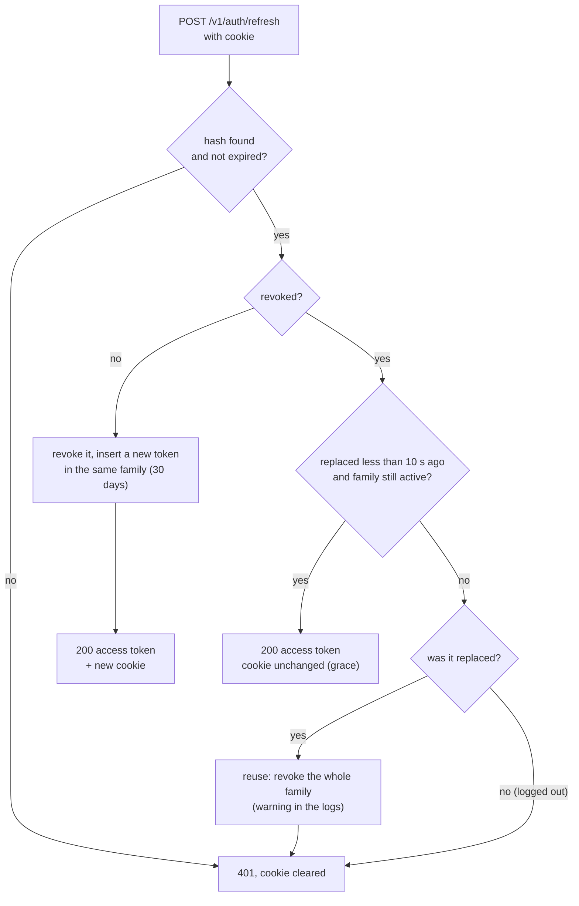

# Authentication

Accounts, access tokens and refresh tokens. Code: `swipread.api.auth`, `swipread.api.security`.

## Endpoints

| Endpoint | Does |
| --- | --- |
| `POST /v1/auth/register` | Creates a `READER` account, returns an access token, sets the refresh cookie |
| `POST /v1/auth/login` | Checks the password, returns an access token, sets the refresh cookie (a new session) |
| `POST /v1/auth/refresh` | Rotates the refresh token and returns a new access token |
| `POST /v1/auth/logout` | Revokes the session of the device and clears the cookie |

Request and response details: [API reference](../api.md#auth).

## Two tokens

| | Access token | Refresh token |
| --- | --- | --- |
| Form | HS256 JWT (`sub`, `roles`, `iat`, `exp`, `iss`) | 32 random bytes, base64url |
| Lifetime | 15 min (`swipread.jwt.ttl`) | 30 days, restarted at each renewal (`swipread.auth.refresh-ttl`) |
| Carried in | `Authorization: Bearer` header | `swipread_refresh` cookie: HttpOnly, `SameSite=Strict`, `Path=/v1/auth`, `Secure` outside `dev`/`test` |
| Stored server-side | No (stateless) | SHA-256 hash in `app.refresh_tokens` |
| Revocable | No: it expires; deleted accounts are refused by an extra validator | Yes: logout, reuse detection, account deletion |

`JwtService` issues access tokens; `SecurityConfig` validates them with Spring Security's Resource Server, plus a validator that refuses tokens of deleted accounts (a primary-key lookup per request).

## Refresh tokens

`RefreshTokenService` manages them in `app.refresh_tokens` (migration V7):

| Column | Meaning |
| --- | --- |
| `id` | UUID |
| `user_id` | Owner, `ON DELETE CASCADE` |
| `family_id` | One login on one device; every rotation stays in the family |
| `token_hash` | SHA-256 of the token, unique |
| `created_at`, `expires_at` | `expires_at` = creation + 30 days |
| `revoked_at` | Set when the token is rotated or its family revoked |
| `replaced_by` | The token that replaced it at rotation |

### Rotation and reuse detection

`rotate(token)` locks the row (`SELECT … FOR UPDATE`) and decides:

- **Grace period (10 s, `swipread.auth.refresh-grace`).** Two tabs can renew at the same moment with the same cookie. The second request arrives with a token that was just replaced; instead of treating it as theft, it gets an access token and the browser keeps the newer cookie.
- **Reuse.** A replaced token presented after the grace period means someone else holds an older copy: the family is revoked and every holder must log in again.
- **Logout** revokes the whole family of the presented token.
- **Purge.** A nightly job (03:30 UTC) deletes tokens expired for more than a day.
- **Role refresh.** The access token issued at renewal reads the role from the database, so a promotion or demotion applies within 15 minutes.

### Cookie and CSRF

The refresh endpoints authenticate with a cookie, so they could be targeted by cross-site requests. They are protected by `SameSite=Strict` (the browser does not send the cookie from another site), by CORS (credentials allowed for the configured origins only), and by the fact that their response (an access token) cannot be read cross-origin. Every other endpoint authenticates with the `Authorization` header, which a browser never adds by itself, so CSRF tokens are not needed.

## Accounts

- **Sign-up** normalises the email (trimmed, lowercase), hashes the password with BCrypt, generates a `u_` ULID and defaults the locale to `fr-FR`. A duplicate email answers 409, including the race where two sign-ups hit the unique constraint.
- **Login** answers 401 `"Invalid email or password"` for any mismatch, and runs a BCrypt check against a dummy hash when the email is unknown, so timing does not reveal accounts.
- **Roles**: `READER` (default) or `ADMIN` (column `app.users.role`, migration V3). There is no endpoint to change a role; see [Configuration](../configuration.md#production-checklist).

## Tests

`AuthIntegrationTest` (sign-up, login, 401/409/400 as `ProblemDetail`, English validation messages with codes), `RefreshTokenIntegrationTest` (cookie attributes, 15-minute token, rotation, grace period, reuse revoking the family, missing/unknown/expired tokens, logout, account deletion, CORS with credentials, hashed storage), `RoleIntegrationTest`, `CorsIntegrationTest`.
