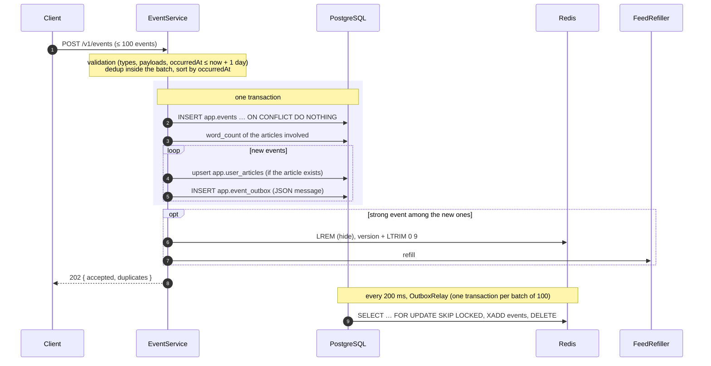

# Events

Clients report every interaction through `POST /v1/events`. The API stores them, aggregates them per article, reacts to strong signals and publishes them to the recommender. Code: `swipread.api.event`.

## Ingestion



### Validation

- Bean Validation on the batch (`sessionId`, 1–100 events, field sizes, `type` among the ten known types).
- `occurredAt` at most one day in the future (clock skew tolerance).
- Payload per type (`EventPayloads`): `view.dwellMs` and `read.readMs` required, between 0 and 86,400,000; `read.scrollDepth` optional, between 0 and 1; `share.channel` required; `hide.reason` optional string.
- One invalid event rejects the whole batch with 400 and a `detail` naming it: `"Event e_01J9X (read): scrollDepth must be between 0 and 1"`.

### Deduplication and order

- Inside a batch, a repeated `eventId` counts once.
- Across batches, the primary key `(event_id, occurred_at)` of `app.events` ignores an identical resend (`ON CONFLICT DO NOTHING`): it is neither re-aggregated, nor republished, nor does it trigger an invalidation. The same `eventId` with another date would not be detected: a partitioned table cannot have a unique index without the partition key.
- Events are applied in `occurredAt` order, so an `unlike` after a `like` in the same batch wins.

## Aggregation

For each new event whose article exists, `app.user_articles` is upserted:

| Type | Effect |
| --- | --- |
| any | Creates the row; `first_seen_at` = earliest `occurredAt` |
| `view` | `total_dwell_ms += dwellMs` (capped at the integer maximum) |
| `open` | `opened_at` = latest of old and new |
| `read` | `max_scroll` = highest `scrollDepth` when sent; `opened_at` = latest |
| `like` / `unlike` | `liked_at` = `occurredAt` / `NULL` |
| `save` / `unsave` | `saved_at` = `occurredAt` / `NULL` |
| `hide` | `hidden_at` = `occurredAt` |

`readMs` is not added to `total_dwell_ms`: dwell time is time on the card in the feed, reading time is time spent on the source's site. An event on an unknown article is stored and published but not aggregated (foreign key of `app.user_articles`).

## Strong events

`StrongEventPolicy` marks as strong: `like`, `save`, `share`, `hide`, and a `read` that is complete:

- `scrollDepth > 0.8` (contract rule), **or**
- `readMs` ≥ 60 % of the estimated reading time, `wordCount` / 230 words per minute (the web client cannot measure scrolling on a third-party site).

Example: an 850-word article reads in 3 min 42 s; a `read` is strong from `readMs` = 133,044.

Strong events trigger the feed invalidation (see [Feed](feed.md#invalidation-on-strong-events)); a `hide` also removes the article from the stock. `unlike` and `unsave` do not invalidate.

## Publication through the outbox

Messages for the recommender are not sent to Redis directly. `EventOutbox.enqueue` writes them to `app.event_outbox` **in the same transaction** as the events (it refuses to run outside a transaction), and `OutboxRelay` publishes them:

- every 200 ms, batches of up to 100 rows in insertion order, `SELECT … FOR UPDATE SKIP LOCKED`;
- `EventStreamPublisher` runs `XADD events MINID ~ <now − 7 days> * data <json>`: one field `data` holding the contract's JSON, with approximate trimming to 7 days (a stream has no TTL);
- published rows are deleted in the same transaction.

Consequences:

- a message is published only if its events were committed;
- a Redis outage no longer fails `POST /v1/events`: messages wait in the outbox;
- if Redis fails mid-batch, the transaction rolls back and the batch is sent again, so a message can be published twice (the recommender is idempotent on `eventId`);
- several API instances share the outbox thanks to `SKIP LOCKED`; order is then guaranteed within a batch only.

Message format (contract `version: 1`), with `articleWordCount` added to the payload:

```json
{
  "version": 1,
  "eventId": "e_01J9X",
  "userId": "u_42",
  "sessionId": "s_8f3a",
  "type": "view",
  "articleId": "a_387",
  "requestId": "r_7c21",
  "position": 3,
  "occurredAt": "2026-10-12T10:41:12Z",
  "receivedAt": "2026-10-12T10:41:15Z",
  "payload": { "dwellMs": 4200, "articleWordCount": 850 }
}
```

Account deletion publishes a `user_deleted` message the same way (no `articleId`, no `sessionId`), see [Account](account.md#account-deletion).

## Partitions

`app.events` is partitioned by month on `occurred_at`. `EventPartitionJob` creates the partitions of the current and next month at startup and every night at 03:00 UTC (`CREATE TABLE IF NOT EXISTS`, safe on several instances). `app.events_default` catches events outside existing partitions instead of failing the insert. See [Database](../database.md#partitioning-of-appevents).

## Tests

`EventServiceTest` and `EventRulesTest` (dedup, chronological order, `articleWordCount`, strong events including the reading-time rule, payload validation, effect on `user_articles`), `EventIntegrationTest` (storage, aggregation, publication, dedup, invalidation, partitions), `OutboxIntegrationTest` (committed messages published in order then removed, nothing published for a rolled-back transaction, enqueue outside a transaction refused).
