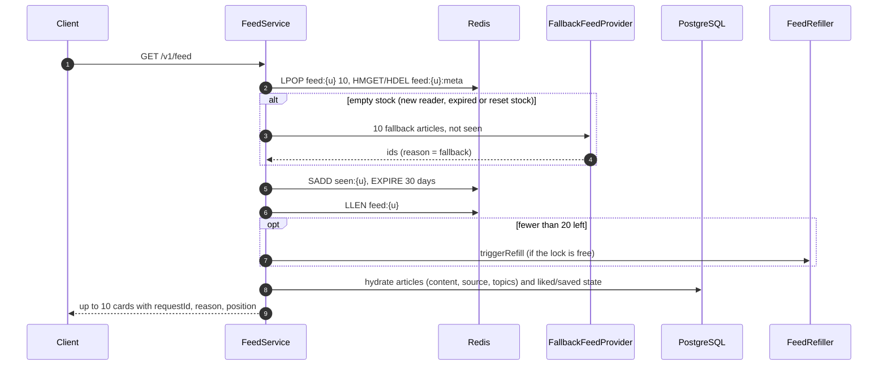
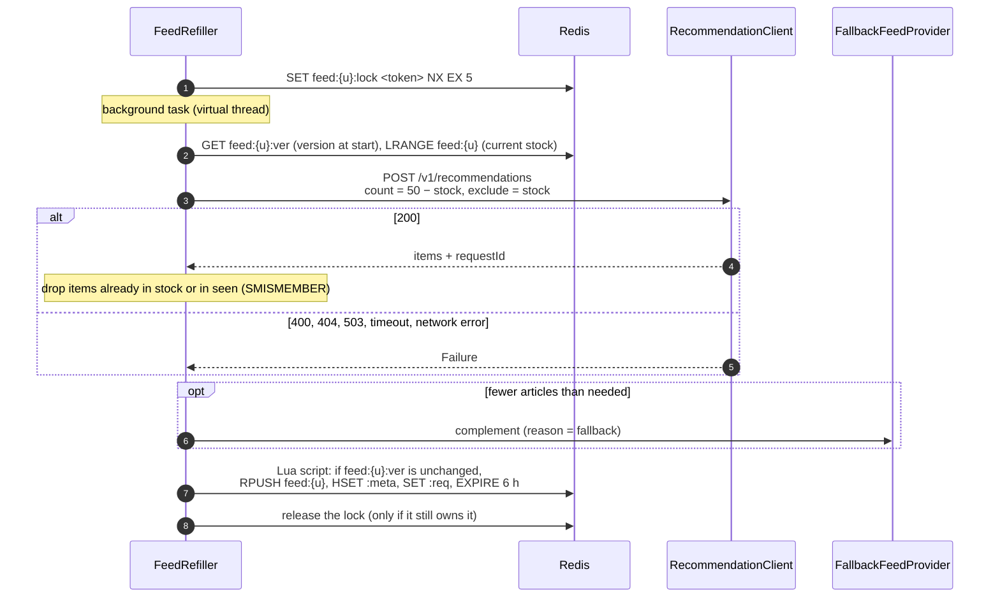

# Feed

`GET /v1/feed` serves the reader's next 10 articles from a stock prepared in Redis, so the reader never waits for the recommender. Code: `swipread.api.feed`, `swipread.api.article`.

## Redis keys

| Key | Type | TTL | Content |
| --- | --- | --- | --- |
| `feed:{userId}` | List | 6 h | Up to 50 article ids, in display order (the stock) |
| `feed:{userId}:meta` | Hash | 6 h | `articleId → requestId\|reason`: the batch each article in stock came from |
| `feed:{userId}:req` | String | 6 h | `requestId` of the latest batch received from the recommender |
| `feed:{userId}:lock` | String | 5 s | Refill lock, with a random owner token |
| `feed:{userId}:ver` | String | 6 h | Stock version, incremented before every invalidation or reset |
| `seen:{userId}` | Set | 30 days, renewed at each page | Articles already served |
| `fallback:{slug}` | List | 1 h, written by the recommender | Recent popular articles per topic |

The sizes (10 per page, 50 in stock, refill under 20) are configurable, see [Configuration](../configuration.md). All access goes through `FeedStore`.

## Serving a page

- An id that no longer exists in the database is skipped, so a page can hold fewer than 10 cards.
- With an empty stock the page comes straight from the fallback feed, without calling the recommender, and is not added to the stock. The recommender refill starts right after.
- Each card carries `requestId` and `reason` from `feed:{userId}:meta` (`FeedOrigin`), which the client copies into its events.

## Refilling the stock

- **Execution.** Refills run on virtual threads, at most 64 at once (`FeedConfig`), which bounds concurrent calls to the recommender. Errors are logged and the lock is always released.
- **Lock.** `SET NX EX 5` with a random token; a Lua script releases it only if the token matches. The 5-second TTL covers an instance that dies mid-refill.
- **Seen filter.** The recommender excludes the reader's history from the database, but a served article only reaches the database when its events arrive (up to a few seconds later). `seen:{userId}` covers that gap. It is never read whole (up to 30 days of history): `SMISMEMBER` checks only the candidates (`FeedStore.seenAmong`).
- **Version check.** A refill reads `feed:{userId}:ver` when it starts. Its batch is appended only if the version is unchanged, atomically in a Lua script: an invalidation or topic change that happened during the recommender call (up to 300 ms) discards the batch instead of appending articles computed without that signal. The refill then recomputes once, still holding the lock. The version is incremented **before** the stock is modified, so an append that lands in between is already refused.

## Fallback feed

`FallbackFeedProvider.articleIds(userId, count, excluded)`:

1. Reads the `fallback:{slug}` lists of the reader's topics (written by a recommender batch job).
2. Merges and shuffles them, removes the excluded ids (current stock) and the ones in `seen:{userId}` (`SMISMEMBER` on these candidates only).
3. If that is not enough, completes with the most recent articles in the database (50 at most), read in batches of 100 with keyset pagination on `(published_at, id)`; only each batch is checked against `seen`.

Fallback articles carry `requestId = "fallback"` and `reason = "fallback"`. With no recommender batch ever run (no `fallback:*` lists, as in development), the fallback feed is simply the most recent articles.

## Invalidation on strong events

A `like`, `save`, `share`, `hide` or complete `read` signals a change of taste (see [Events](events.md#strong-events)). `FeedRefiller.invalidate`:

1. **Keeps the next page.** `INCR feed:{userId}:ver`, then `LTRIM feed:{userId} 0 9` (a Lua script that also drops the metadata of removed articles): the next 10 articles stay, so scrolling remains smooth.
2. **Recomputes the rest.** A refill starts and takes the new signal into account.

A `hide` also removes the hidden article from the stock (`LREM`).

## Topic change

`PUT /v1/me/topics` makes the whole stock obsolete. `TopicService` publishes `UserTopicsChanged`; `TopicsChangedListener` receives it **after the commit** (`@TransactionalEventListener`), increments the version and deletes `feed:{userId}`, `:meta` and `:req`. `seen:{userId}` and the lock are kept.

No refill starts at that moment: the next `GET /v1/feed` finds an empty stock, serves its first page from the fallback feed on the new topics and starts the recommender refill, like for a new reader. The Spring event avoids a dependency from `topic` to `feed`, which already depends on `topic`.

## Hydration

`ArticleQueryService.hydrate(ids)` loads articles with their source name and topics (most confident first) and keeps the requested order. `UserArticleStates` adds `liked` and `saved` in one query. The `embedding` column is never mapped by the API.

## Tests

`FeedServiceTest` (paging, liked/saved state, refill threshold, empty stock), `FeedRefillerTest` (lock, count and exclude, fallback complement, seen filter, invalidation, batch discarded and recomputed once on a version change), `FeedIntegrationTest` (first page from the fallback, asynchronous refill to 50, Redis keys, no duplicates across pages, stock emptied on topic change), `FallbackFeedProviderIntegrationTest`, `FeedStoreIntegrationTest`.
