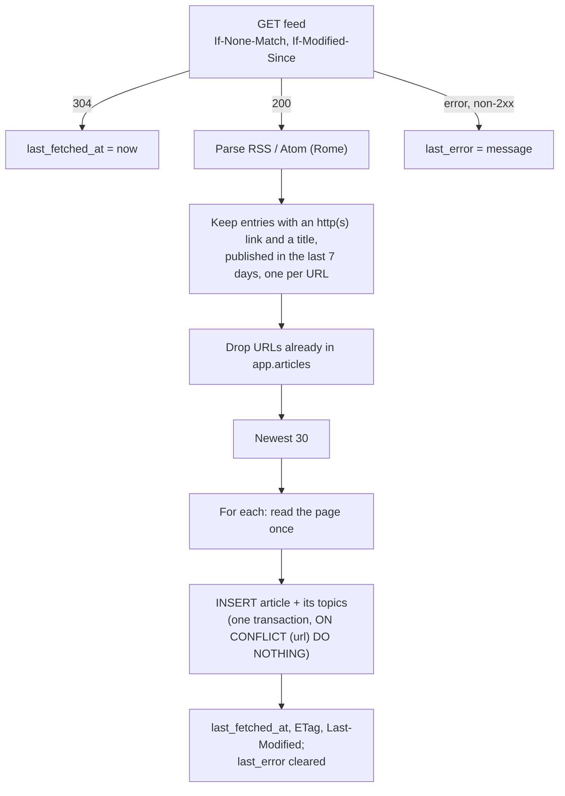

# Ingestion

Reads the RSS and Atom feeds of the sources and saves their new articles, with their topics, for the feed and the recommender (contract v1.5). Code: `swipread.api.ingestion`, plus the HTTP client in `swipread.api.source`.

## When it runs

`IngestionJob` runs a pass every 15 minutes (`swipread.ingestion.interval`, counted from the end of the previous pass), the first one a minute after startup. It only exists when `swipread.ingestion.enabled` is `true`: the default, so on in production, and `false` in the `dev` and `test` profiles. Set `SWIPREAD_INGESTION_ENABLED=true` to try it in `dev`. Integration tests call `IngestionService` themselves.

A pass reads every **active** source that has **at least one topic**, one after the other. A source without topics (only possible for sources created before topics existed) or an inactive one is skipped.

**One pass at a time.** `IngestionService.runOnce` takes a PostgreSQL advisory lock (`pg_try_advisory_lock`) on a dedicated connection for the whole pass. Another instance of the API that starts its pass meanwhile gets `skipped` and does nothing, so running several instances is safe.

## Reading a source

| Field | Value |
| --- | --- |
| `id` | `a_` + ULID |
| `url` | The entry's link (or id), made absolute against the feed's URL, without fragment, `http`/`https` only, at most 2048 characters. Unique: the same article is never saved twice, even by two sources |
| `title` | Without HTML or entities, at most 300 characters. Entries without a title are skipped |
| `summary` | The entry's description (or content) without HTML, cut at a word boundary to 400 characters |
| `author` | The entry's author, at most 200 characters; omitted when absent |
| `published_at` | Publication date, else update date; **now** when absent or in the future |
| `language` | The source's language |
| `image_url` | Image enclosure, `media:content` or `media:thumbnail` (Media RSS) of the entry, else the page's `og:image` or `twitter:image` |
| `word_count` | See below; always at least 1 |

**Topics.** Each article gets its source's topics (`app.source_topics`) with confidence 1.0, 0.9 and 0.8 in the order the admin chose: the first one is its main topic for the recommender. Changing a source's topics does not change the articles already saved.

**Limits.** Entries published more than 7 days ago are skipped (`swipread.ingestion.max-age`), and a source brings at most 30 new articles per pass, the newest first (`max-new-per-source`); the next pass takes the following ones while they are recent enough.

## Reading the page of an article

`PageReader` opens each new article's page **once**, to count its words and find its image. The text is not kept.

1. **robots.txt.** Read once per site and per pass, for the robot named by the first word of the User-Agent (`SwipreadBot`), else the `*` group (RFC 9309: longest matching rule wins, `Allow` on ties, `*` and `$` supported). A missing robots.txt (4xx) allows everything; a server error (5xx) or an unreachable site forbids everything, for lack of knowing.
2. **Fetch** with `SafeHttp` (below): 5 s to connect and to answer, 2 MB at most, HTML (`text/html`, `application/xhtml+xml`) only. The charset comes from `Content-Type`, else from the page's `<meta charset>`.
3. **Is it the article?** The first four words of the entry's title (lowercase, without accents or punctuation) must appear in the page's `<title>`, `og:title`, `<h1>` or text. Otherwise the page is ignored, neither its words nor its image are used: some sites answer bots with a challenge or consent page in 200.
4. **Word count**, in this order:
   1. the `wordCount` the page declares in schema.org JSON-LD, for an object of type `…Article`, `BlogPosting` or `Report` (also inside `@graph`);
   2. else the words of its `articleBody`;
   3. else the words of the page's main text: the longest `<article>` that is not inside another one, without the `<article>` it contains ("read also" cards), else `<main>`, else `<body>`, always without `nav`, `header`, `footer`, `aside`, `form`, scripts and styles.

   A word is a run of letters or digits, with inner apostrophes and hyphens (« aujourd'hui », « porte-parole »).

When the page cannot be used (forbidden, unreachable, not HTML, not the article), `word_count` counts the entry's content in the feed, else its title and summary.

**Why it matters.** `word_count` sets the estimated reading time (`word_count` / 230 words per minute) behind the "complete read" rule of the events (`read` with `readMs` ≥ 60 % of it). A count taken from a 40-word summary makes almost any opening a complete read.

### Measured on real feeds (19/11/2026)

| Feed | Articles | Words | Images | Note |
| --- | --- | --- | --- | --- |
| Le Monde, Sciences | 20 | 31 to 69 | 20 (feed) | Pages answer bots with a « Client Challenge »: ignored, words from the feed |
| franceinfo, Sciences | 16 | 290 to 834 | 16 | JSON-LD `wordCount`; the page's text with its newsletter blocks gave 821 to 1404 |
| BBC News, Science | 24 | 44 to 1845 | 24 | No JSON-LD count: main text |

A pass over these three feeds (60 new articles, 60 pages) took about 10 seconds.

## The HTTP client

`SafeHttp` (`swipread.api.source`) is the client of the source check, shared with the ingestion through `SafeHttpFactory`: Apache HttpClient 5 whose DNS resolver is `FeedAddressPolicy.resolve`, redirects followed by hand and checked at each hop, no system proxy, no automatic retry. Feeds, pages and robots.txt are therefore under the same SSRF protection as the source check (see [Sources](sources.md#ssrf-protection)): a feed cannot make the API read an internal address through an article link or a redirect. It returns non-2xx responses (`304`, a robots.txt `404`) instead of failing; the body is only read for 2xx.

## Errors

A source that fails keeps the error of its last read in `app.sources.last_error` (shown in the administration), and the pass goes on with the next one; a later successful read clears it, and `last_fetched_at` is the last successful read.

| `last_error` | Cause |
| --- | --- |
| `Feed answered HTTP <status>` | The feed answered an HTTP error |
| `Feed is unreachable` | Connection failure or timeout |
| `Not a valid RSS or Atom feed` | Parsing failed (including a `DOCTYPE`: no external entities) |
| `Feed address is not allowed` | SSRF protection |
| `Feed redirects too many times`, `Feed is larger than 5 MB` | Limits |
| `Ingestion failed` | Unexpected error, logged with its stack trace |

Each pass logs one line: `Ingestion: <n> sources read, <n> new articles, <n> failures`.

## Configuration

| Property | Default | Environment variable |
| --- | --- | --- |
| `swipread.ingestion.enabled` | `true` (`false` in `dev` and `test`) | `SWIPREAD_INGESTION_ENABLED` |
| `swipread.ingestion.interval` | `15m` | `SWIPREAD_INGESTION_INTERVAL` |
| `swipread.ingestion.initial-delay` | `1m` | `SWIPREAD_INGESTION_INITIAL_DELAY` |
| `swipread.ingestion.max-age` | `7d` | `SWIPREAD_INGESTION_MAX_AGE` |
| `swipread.ingestion.max-new-per-source` | `30` | `SWIPREAD_INGESTION_MAX_NEW_PER_SOURCE` |
| `swipread.ingestion.user-agent` | `SwipreadBot/1.0 (+https://github.com/Swipread/api)` | `SWIPREAD_INGESTION_USER_AGENT` |

## Licences

Swipread stores the title, the summary, the link and the address of the image, never the text. Some publishers still forbid any reuse beyond personal use without a licence (Le Monde says so in its robots.txt). Check the conditions of each source before adding it, and record them in its `license` field.

## Tests

`IngestionIntegrationTest`, against a local site (`TestSite`) that serves a feed, its pages and a robots.txt:

- articles saved with the page's words (main text without navigation, footer or nested cards; or the JSON-LD `wordCount`), the page's or the feed's image (Media RSS, also without `medium`), the title and summary without HTML, the author, the source's language, the source's topics with confidence 1.0 then 0.9;
- a page forbidden by robots.txt never requested (words of the feed's content), a PDF and a bot challenge page ignored (words of the title and summary), an entry without date dated now, a 10-day-old entry and a duplicate URL skipped;
- the `ETag` sent back and `304` handled, known articles not saved again;
- at most 30 new articles per read, the newest first, the rest at the next read;
- a failing source keeps `Feed answered HTTP 404` while the others are read, sources without topics and inactive ones skipped, the error cleared by a successful read;
- a second pass skipped while the advisory lock is held.

`ArticleTextTest` (HTML and entities, word count, summary cut, main text and nested cards, page recognition, share image, absolute URLs, declared word count) and `RobotsRulesTest` (own group or `*`, longest rule, `Allow` on ties, wildcards and anchors, agents sharing a group, empty `Disallow`).
