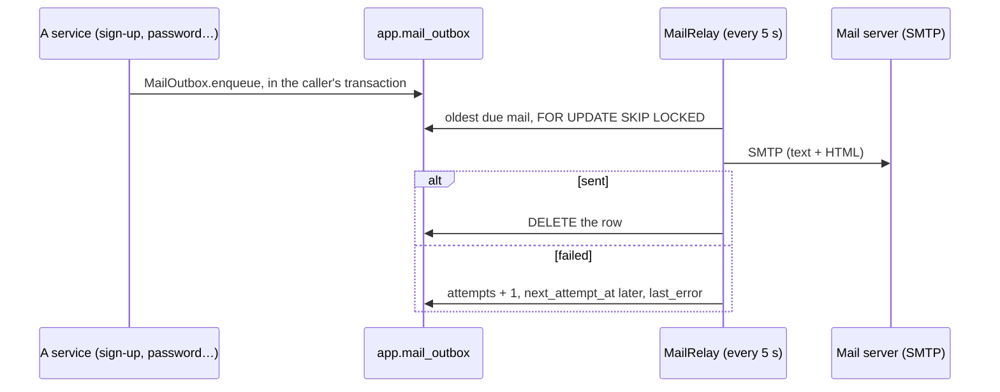

# Mail

Mails sent by the API: address verification, forgotten password and password change notice (coming with the next features). Code: `swipread.api.mail`.

## How a mail leaves

- **Outbox.** `MailOutbox.enqueue(MailMessage)` writes the mail in `app.mail_outbox` in the caller's transaction (or its own if there is none). A mail is only sent if the transaction commits, and an unreachable mail server never makes a sign-up or a password change fail.
- **Relay.** `MailRelay` runs every `swipread.mail.relay-interval` (5 s) and sends due mails one by one, up to 50 per run. Each mail stays locked while it is sent: several API instances can relay without sending one twice.
- **Retries.** A failed send is tried again after 1 min, 5 min, 15 min, 1 h, 3 h, 6 h then 12 h: 8 attempts over about 22 hours. After the last one the row gets `failed_at` and is never tried again; the error is logged (`Mail … given up`) and kept in `last_error`.
- **Purge.** Every night at 03:45 UTC, mails given up for more than 7 days are deleted: they hold an address and sometimes a personal link.
- **Account deletion** deletes the mails not sent yet to the account's address (`MailOutbox.forget`).

What happens after the mail server accepted a mail (delivery, bounces) is the mail server's job: see the infra repository's README, « Mail ».

## Content

`MailTemplate` gives every mail the same shape: a title (also the subject), paragraphs, an optional button with its link, and a footnote. It renders a plain text part and an HTML part (inline styles, 520 px wide, system fonts); every variable text is HTML-escaped. Mails are in French.

The sender is `swipread.mail.from` with the name `Swipread`. Its domain must be the one the mail server accepts and signs (DKIM): any other is refused. The `Message-ID` uses the same address (`mail.from`), not the container's name.

## Configuration

| Property | Default | Notes |
| --- | --- | --- |
| `swipread.mail.from` (`SWIPREAD_MAIL_FROM`) | required | `noreply@swipread.local` in `dev`, `noreply@swipread.test` in `test` |
| `spring.mail.host` (`SWIPREAD_MAIL_HOST`) | `mail` | The infra's mail service; `localhost` (Mailpit) in `dev` |
| `spring.mail.port` (`SWIPREAD_MAIL_PORT`) | `587` | `1025` (Mailpit) in `dev` |

SMTP timeouts: 5 s to connect, 10 s to read or write. No authentication and no TLS: the mail server is only reachable on the internal network.

The mail health indicator is off (`management.health.mail.enabled: false`): mails wait in the outbox, so an unreachable mail server does not make the API unhealthy, and a deployment is not rolled back because of it.

## Development

`compose.yaml` starts **Mailpit** (`axllent/mailpit`), a fake mail server that keeps every mail: SMTP on `localhost:1025`, mails readable at <http://localhost:8025>. Nothing ever leaves your machine.

## Tests

`MailIntegrationTest` sends through a Mailpit container (Testcontainers) and reads it back through Mailpit's HTTP API: a committed mail arrives with its sender, subject, text and escaped HTML, then leaves the outbox; a rolled-back mail is never sent; `forget` and account deletion remove pending mails. `MailRelayTest` drives `MailRelay` with a fixed clock and a mail sender that always fails: each retry delay, the give-up after 8 attempts, and the purge a week later.
