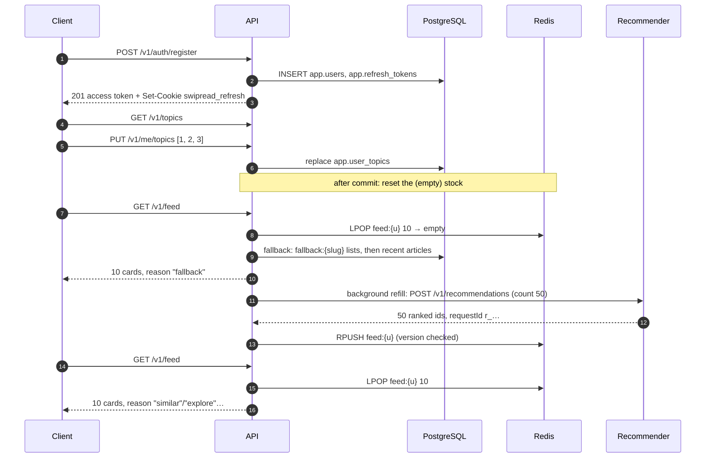
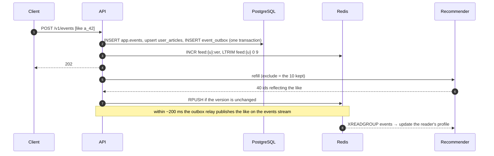
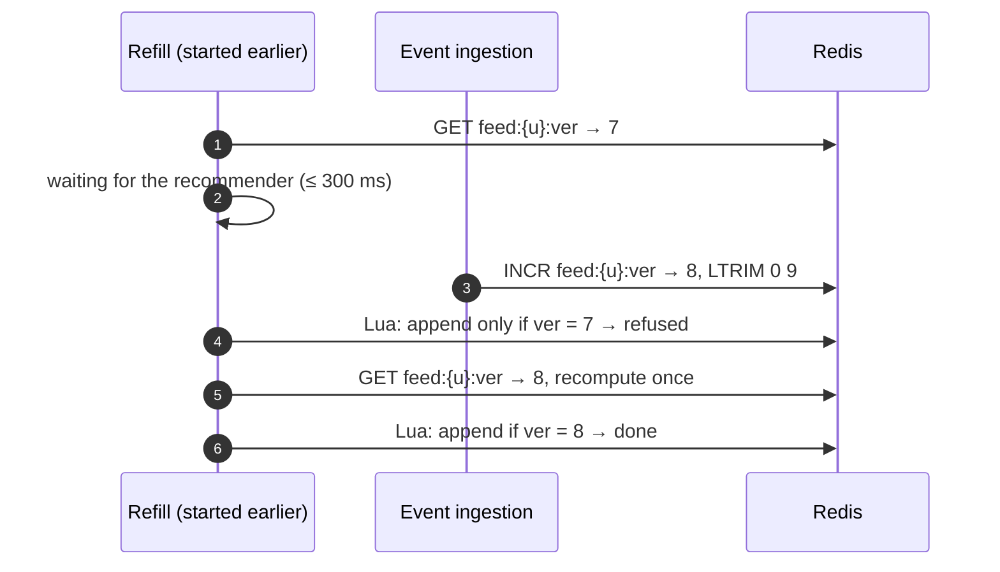
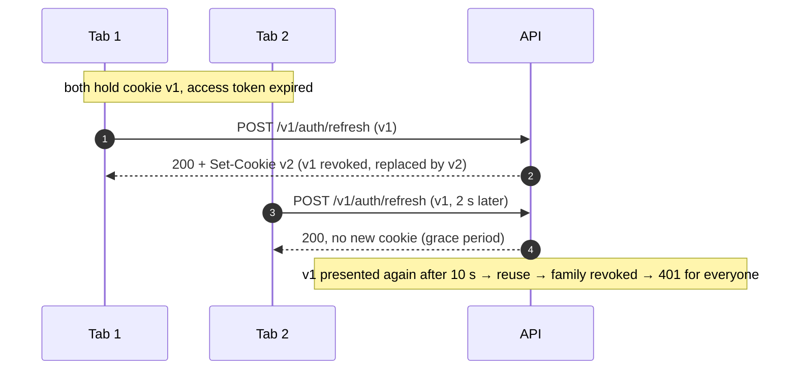
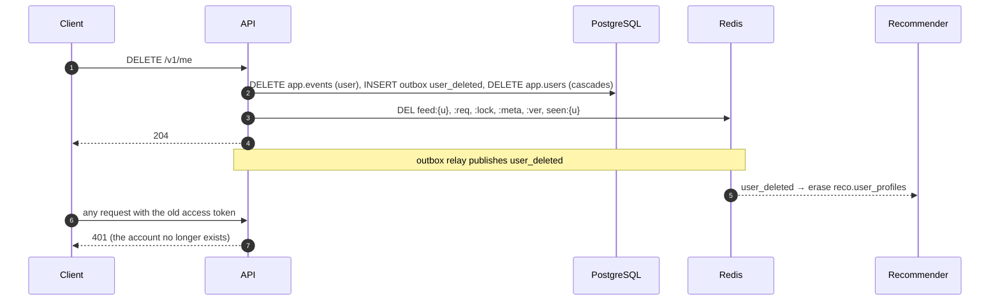
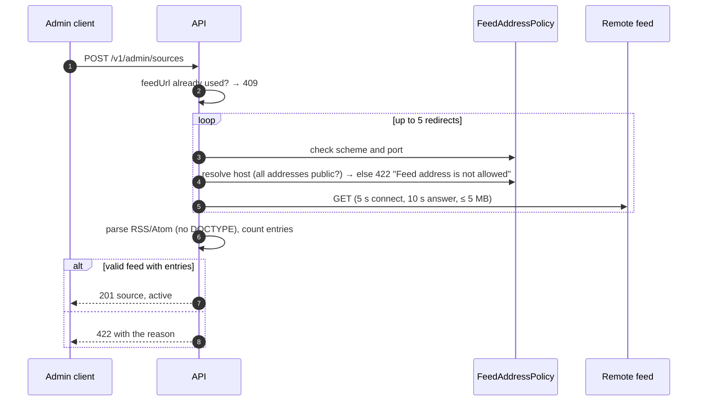

# Flows

End-to-end sequences across modules. Per-module details are in the [feature guides](README.md#features).

## A new reader: sign-up to first feed

## A strong signal changes the feed

The next page still shows the 10 articles that were already queued, then the recomputed ones: scrolling stays smooth while the feed adapts.

## A refill races an invalidation

Without the version, the first batch (computed before the like) would have been appended after the invalidation.

## Token renewal with two tabs

## Account deletion

## Adding a source

